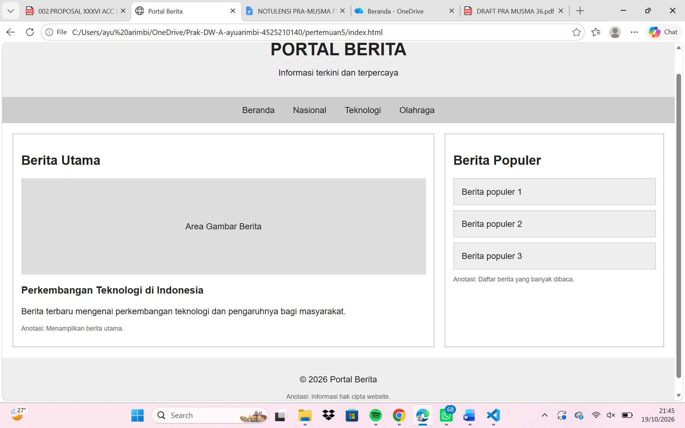

# Pertemuan 5 - Wireframe Portal Berita

**Nama:** Ayu Arimbi  
**NPM:** 4525210140  
**Mata Kuliah:** Praktikum Desain Web

## Deskripsi

Pada tugas pertemuan 5 ini, saya membuat wireframe website portal berita menggunakan HTML dan CSS. Wireframe ini dibuat untuk menentukan susunan bagian website sebelum masuk ke tahap desain yang lebih detail.

Website ini memiliki beberapa bagian, yaitu header untuk nama portal berita, menu navigasi untuk memilih kategori, bagian berita utama, berita populer, dan footer. Saya juga membuat tampilan desktop dan mobile supaya susunan website bisa menyesuaikan ukuran layar.

## Fungsi Bagian Website

- **Header:** Menampilkan nama portal berita.
- **Navigasi:** Berisi menu Beranda, Nasional, Teknologi, dan Olahraga.
- **Berita Utama:** Menampilkan judul dan ringkasan berita utama.
- **Berita Populer:** Menampilkan beberapa berita populer.
- **Footer:** Menampilkan informasi hak cipta.

## Screenshot

### Tampilan Desktop

### Tampilan Mobile

## Perubahan, Masalah, dan Solusi

Saat membuat wireframe ini, saya menyusun bagian-bagian website menggunakan HTML, kemudian mengatur tampilannya menggunakan CSS. Saya membuat tampilan desktop dengan bagian berita utama dan berita populer yang berada berdampingan.

Masalah yang perlu diperhatikan adalah tampilan website ketika dibuka melalui layar HP. Jika susunannya tetap seperti desktop, bagian website bisa terlihat terlalu sempit. Untuk mengatasinya, saya menggunakan media query pada CSS agar bagian berita utama dan berita populer tersusun ke bawah ketika ukuran layar lebih kecil.

Dari tugas ini, saya belajar bahwa susunan website perlu direncanakan terlebih dahulu supaya lebih mudah diperbaiki jika ada perubahan.

## Pembagian Tugas

- Pembuatan HTML: Ayu Arimbi
- Pengaturan CSS: Ayu Arimbi
- Pengecekan tampilan desktop dan mobile: Ayu Arimbi
- Dokumentasi dan screenshot: Ayu Arimbi